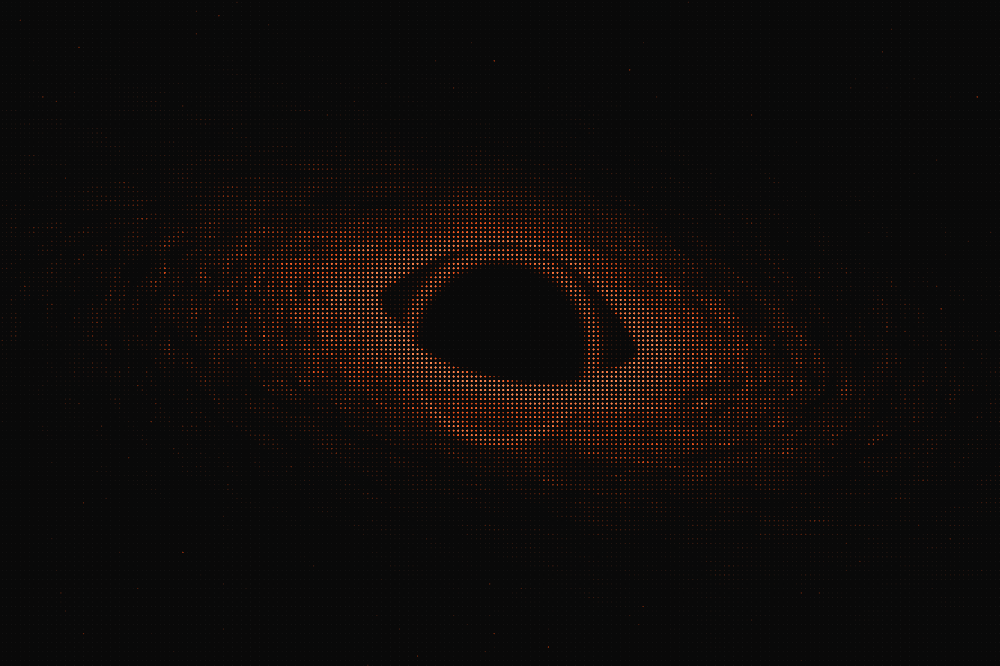
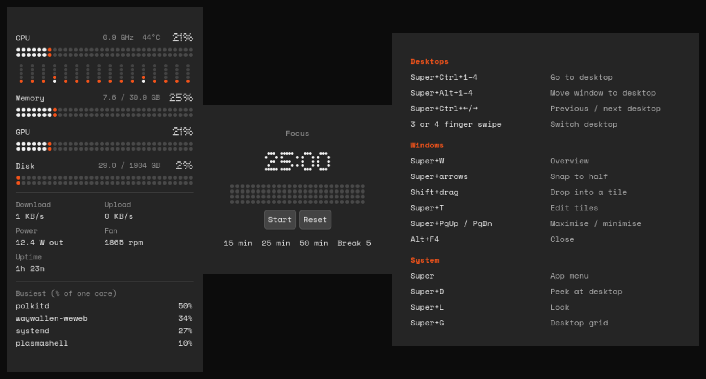

# Framework Dots

A black, grey and orange dot-matrix look for your Linux desktop (**KDE Plasma 6**).




New to Linux? This guide assumes no experience. Copy each grey box into a terminal and press Enter.

1. [Will it work on my computer?](#1-will-it-work-on-my-computer)
2. [Install the theme](#2-install-the-theme)
3. [Add the bar, dock and widgets](#3-add-the-bar-dock-and-widgets) (optional)
4. [Get the dotted font](#4-get-the-dotted-font)
5. [Set the wallpaper](#5-set-the-wallpaper)
6. [Undo everything](#6-undo-everything)
7. [Something went wrong](#7-something-went-wrong)

---

## 1. Will it work on my computer?

You need **KDE Plasma 6**. To check, open the app menu, search for **About this System**, and look for
**KDE Plasma Version**. If it starts with 6, you're fine. It won't work on GNOME, Cinnamon or XFCE.

### Tested on

I built this on **one computer**, and that's the only one it has been used on:

| | |
|---|---|
| **Computer** | Framework Laptop 13 Pro (Intel Core Ultra X7 358H, Intel Arc B390 graphics, 32 GB RAM) |
| **Screen** | One built-in screen, 2880x1920 at 200% scale |
| **Distro** | CachyOS (based on Arch), kernel 7.3.5 |
| **Desktop** | KDE Plasma 6.8.3 on Wayland (Qt 6.12, KDE Frameworks 6.32) |
| **Moving wallpaper** | Waywallen 0.6.1 with its KDE plugin 0.4.6 and web wallpaper plugin 0.3.4 |

**Not tested:**

| | What to expect |
|---|---|
| Other distros (Fedora, Kubuntu, KDE neon and so on) | Should mostly work on Plasma 6. The volume pop-up is skipped if KDE keeps its files somewhere else |
| Other Plasma 6 versions | Most things should work. The volume pop-up and widgets are the likeliest to break |
| X11 | Unknown |
| Several screens, or 100% scale | Unknown. Dots may look less crisp at 100% |
| NVIDIA or AMD graphics | The theme should be fine. For the moving wallpaper, see Waywallen's notes on NVIDIA |
| Plasma 5, GNOME, XFCE, Hyprland and others | Won't work, though the still wallpapers are just pictures |

The installer and `--layout` were also tested in a fresh, hidden Plasma session on the same computer, but not yet by a real
new user.
If you try it on something else, please open an **Issue** and say how it went.

## 2. Install the theme

**Open a terminal:** open the app menu, type `konsole`, and press Enter. Any terminal will do.

**Install git**, which downloads the files. Pick your system:

| System | Command |
|---|---|
| Arch, CachyOS, EndeavourOS, Manjaro | `sudo pacman -S git` |
| Fedora | `sudo dnf install git` |
| Ubuntu, Kubuntu, KDE neon, Debian | `sudo apt install git` |

It asks for your password. Nothing appears while you type it; that's normal.

**Download and install the theme:**

```
cd ~
git clone https://github.com/BocchiTheRockEnjoyer/framework-dots.git
cd framework-dots
./install.sh
```

Don't put `sudo` in front of `./install.sh`. When it says **Done**, **log out and back in**.

> **What it changes:** KDE colours, icons, fonts, splash screen, the volume pop-up and some Dolphin (file manager) settings,
> plus your **kitty** terminal settings. It saves your old ones first, in `~/.local/share/framework-dots-backup-…`.
> `~` means your home folder.

## 3. Add the bar, dock and widgets

Optional. This adds a top bar, a dock, and a clock and media player on the desktop:

```
cd ~/framework-dots
./install.sh --layout
```

Run it **only once**, or you'll get two of everything. Then:

- **Remove your old panel:** right-click it, choose **Show Panel Configuration**, then **Remove** or **Delete**.
- **Keep apps in the dock:** open an app, right-click it in the dock, choose **Pin to Task Manager**.
- **Turn on weather:** right-click the clock in the top bar, choose **Configure**, and type your city.
  Your city is sent to [open-meteo.com](https://open-meteo.com); without one, nothing is sent.
- **Move the desktop widgets:** right-click the desktop, choose **Enter Edit Mode**, and drag them.



You can also add single widgets: right-click the desktop, **Add Widgets**, and search for **Dot**.

## 4. Get the dotted font

Some text uses a font called **Ndot 55**. It belongs to Nothing, so I can't include it. Everything works without it,
but that text won't be dotted.

If you have the font file (`.otf` or `.ttf`), double-click it and choose **Install**, then log out and back in.
The clock on the desktop doesn't need it.

## 5. Set the wallpaper

Choose one. The still picture is much easier.

### Still picture (easy)

1. Right-click the desktop and choose **Desktop and Wallpaper**.
2. Click **Add Image** and open **Pictures → Wallpapers** in your home folder.
3. Pick **dot-matrix-blackhole.png** and click **Apply**.

Or use one command:

```
plasma-apply-wallpaperimage ~/Pictures/Wallpapers/dot-matrix-blackhole.png
```

### Moving wallpaper

The black hole can spin, react to music, and change colour, speed and more. It needs a free app called
[Waywallen](https://github.com/waywallen/waywallen). You **don't** need Steam or Wallpaper Engine.
It uses more battery than the still picture.

**Step 1. Get the apps.** This downloads about 235 MB and checks that the files are genuine:

```
cd ~/framework-dots
./wallpaper-setup.sh
```

The taskbar disappears for a moment. That's normal. (It's for ordinary Intel and AMD computers; on ARM, use Waywallen's own guide.)

**Step 2. Add the wallpaper plugin.**
Open **Waywallen** from the app menu. Click the **puzzle piece** at the bottom left, choose to install a plugin, and pick
`web-wallpaper-plugin.zip` in your **Downloads** folder.
Waywallen warns that plugins can access your files, so only add ones you trust. This one comes from Waywallen's makers.

**Step 3. Show it where the wallpapers are.**
Go to **Wallpapers** and click the **drive icon** at the top right. Add this folder, which the theme installer made:

```
FrameworkDots-Wallpapers
```

It's in your home folder. If it asks what kind, choose **Workshop** or **Wallpaper Engine**. Then click **refresh**.

**Step 4. Turn it on.**
Right-click the desktop, choose **Desktop and Wallpaper**, change **Wallpaper type** to **Waywallen**, and click **Apply**.
The desktop may go blank until the next step.

**Step 5. Pick it.**
In Waywallen, click **Dot Matrix Black Hole** and apply it. Open its settings to change the look.
You can close Waywallen's window; the wallpaper keeps running, and it starts by itself when you log in.

**To save battery:** in Waywallen's settings (the gear), pause it when a window is **maximised** or when **on battery**.
Lowering **Particles** and **Dots across the screen** helps too.

**To go back to a picture,** use the command under [Still picture](#still-picture-easy).

## 6. Undo everything

1. Open **System Settings** and pick another **Colors**, **Icons**, **Plasma Style**, **Splash Screen** and **Fonts**.
2. Remove the bar, dock and widgets you don't want.
3. Delete the files:

```
cd ~/.local/share
rm -r plasma/plasmoids/local.dotboard plasma/plasmoids/local.dotmedia plasma/plasmoids/local.dotclock plasma/plasmoids/local.dotsysmon plasma/plasmoids/local.dotplaying plasma/plasmoids/local.dottimer plasma/plasmoids/local.dotkeys plasma/plasmoids/local.dotdesktops plasma/plasmoids/local.dotbatterypercent plasma/plasmoids/local.claudeusage
rm -r icons/nothing-dots plasma/desktoptheme/breeze-rounded-dock plasma/look-and-feel/framework.dots.desktop plasma-qml color-schemes/FrameworkGraphite.colors
rm ~/.config/systemd/user/plasma-plasmashell.service.d/dot-osd.conf
```

4. If you set up the moving wallpaper, switch to a picture first, then:

```
rm ~/.config/autostart/waywallen.desktop ~/.local/share/applications/waywallen.desktop ~/Applications/waywallen.AppImage
kpackagetool6 --type Plasma/Wallpaper -r org.waywallen.kde
rm -r ~/FrameworkDots-Wallpapers
```

5. Log out and back in. Your old settings are in the `framework-dots-backup-…` folder in `~/.local/share`.

## 7. Something went wrong

| Problem | Try this |
|---|---|
| `git: command not found` | Install git ([step 2](#2-install-the-theme)) |
| `Permission denied` | Run `chmod +x install.sh wallpaper-setup.sh`, then try again |
| `No such file or directory` | Run `cd ~/framework-dots` first |
| Nothing looks different | Log out and back in |
| The top bar or dock disappeared | Run `systemctl --user restart plasma-plasmashell` |
| I have two bars or docks | Right-click one, **Show Panel Configuration**, and remove it |
| Dots behind the top bar | In its panel configuration, set **Opacity** to **Opaque** |
| Dock dots look uneven | In its panel configuration, set the height to **60** |
| Volume pop-up missing after an update | Run `rm ~/.config/systemd/user/plasma-plasmashell.service.d/dot-osd.conf`, then log out and back in |
| Moving wallpaper is frozen | A maximised window may be pausing it. Otherwise, log out and back in |
| Waywallen shows no wallpapers | Check you added **FrameworkDots-Wallpapers** itself, then refresh or restart Waywallen |
| Waywallen won't open | Run `~/Applications/waywallen.AppImage` in a terminal and read the message |

Still stuck? Open an **Issue** at the top of this page. Say which system and Plasma version you have, and paste the error.

---

## More pictures


## Optional extras

- **Floorp browser:** copy the two files in `floorp` into the `chrome` folder of your Floorp profile, and restart it.
  If nothing changes, open `about:config` and set `toolkit.legacyUserProfileCustomizations.stylesheets` to true.
- **Claude Code usage widget:** shows tokens by itself. For plan limits, set `statusLine` in `~/.claude/settings.json` to
  `{"type": "command", "command": "~/.local/bin/claude-usage --record"}`. It only reads files on your computer.
- **Colours:** orange `#F3531A`, boards `#0C0C0C`, outline `#4A4A4A`, graphite `#252525` and `#1A1A1A`.
- **For tinkerers:** `sources` has the rough scripts that drew the icons.

## Credits and licence

- [KDE](https://kde.org): Plasma and Breeze. `osd/OsdItem.qml` is modified from Plasma (GPL-2.0-or-later)
- [Space Mono](https://fonts.google.com/specimen/Space+Mono): SIL Open Font License, in `fonts/space-mono/OFL.txt`
- Framework logo shape from [Simple Icons](https://simpleicons.org)

Licensed GPL-3.0-or-later, except where noted above. The moving wallpaper uses
[Waywallen](https://github.com/waywallen), a separate project that isn't included here.

Not affiliated with Framework, Nothing, KDE or Anthropic. Their names and logos are their own.
