# Framework Dots

A **Nothing-inspired rice** for your Linux desktop (**KDE Plasma 6**): dot-matrix everything, in black or white, with
grey and orange. Made with help from [Claude Code](https://claude.com/claude-code).

**Dark**

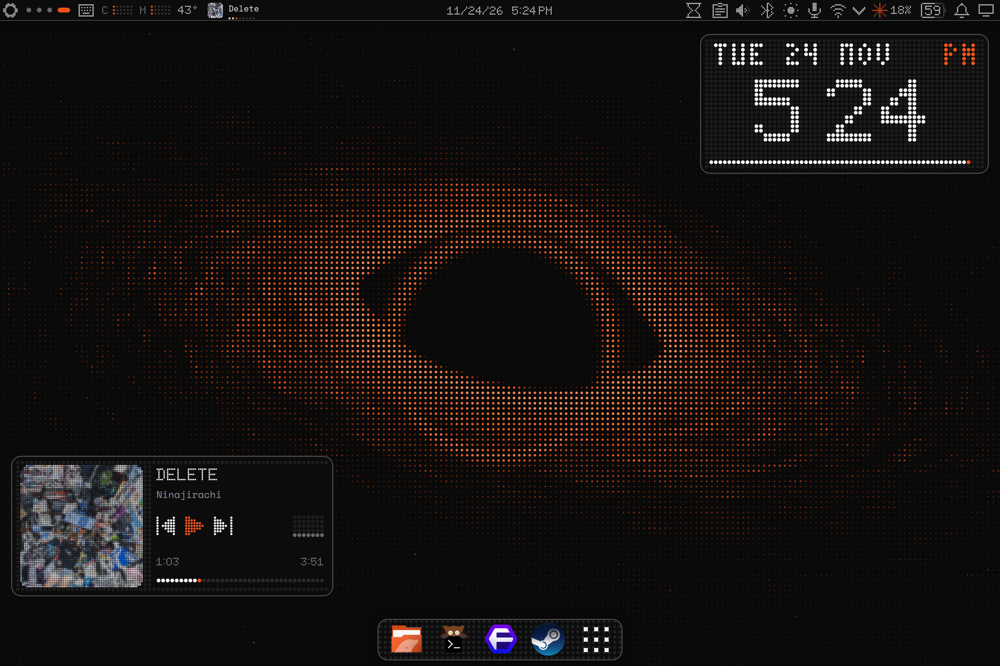

**Light**

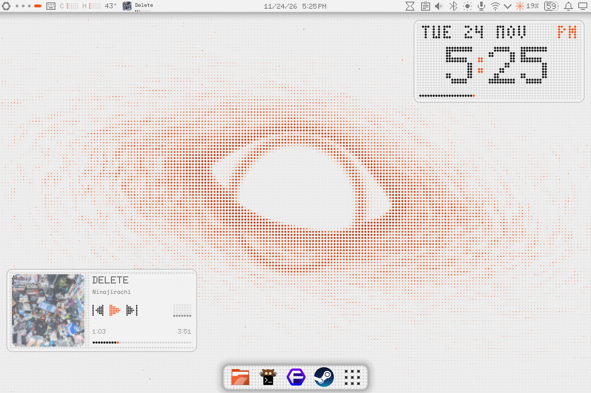

**Any accent colour**

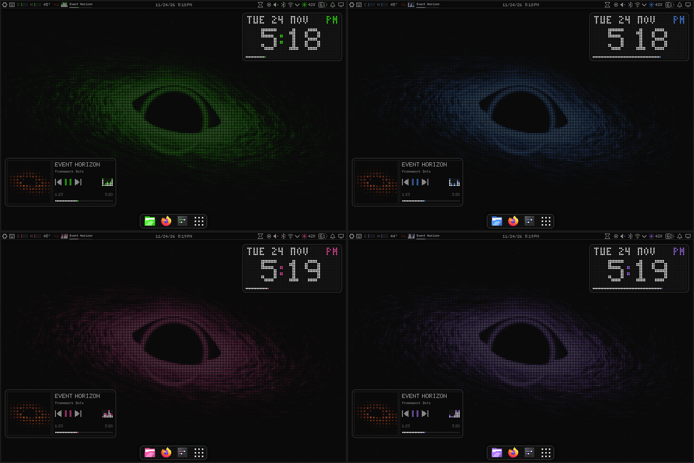

**Windows and terminal**

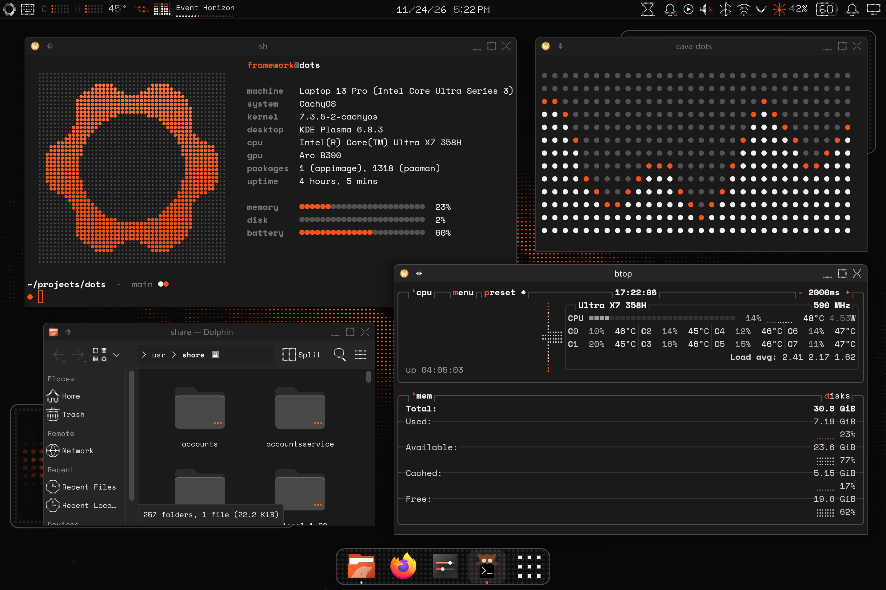

### Widgets

Pictures use demo music and notifications, London weather, and sample Claude usage and slider levels.

**Clock, calendar and weather**

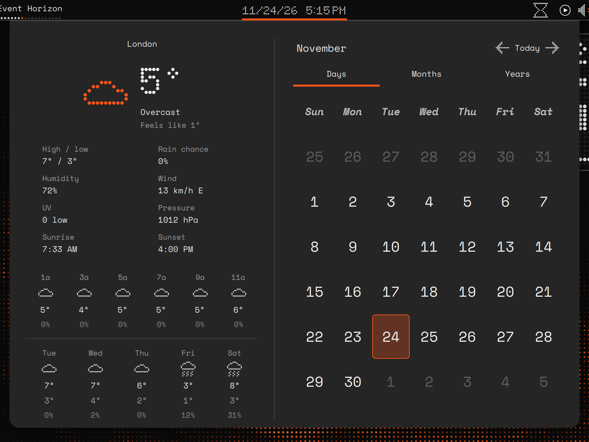

| Music player | System monitor |
|:---:|:---:|
| 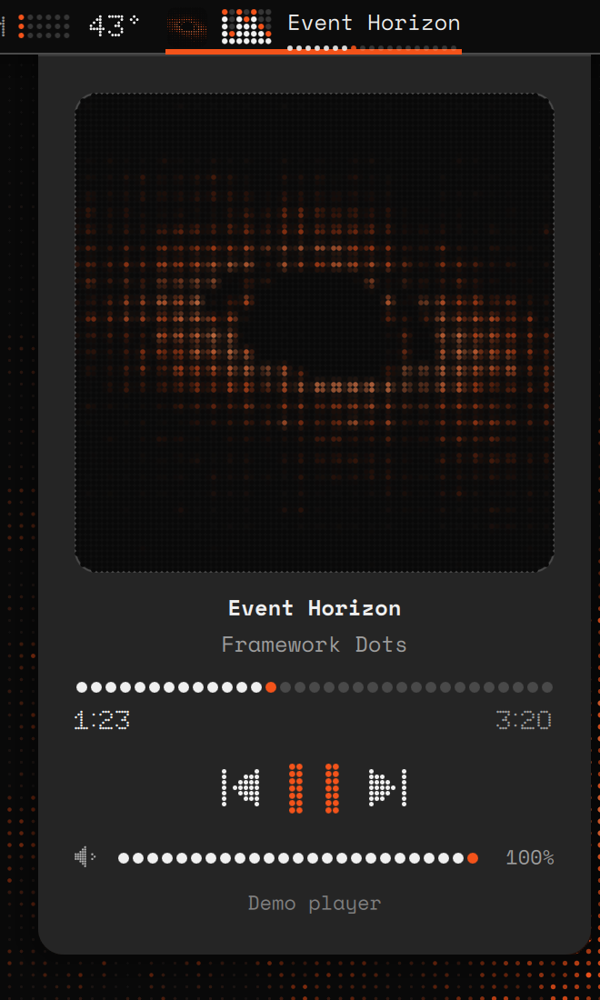 | 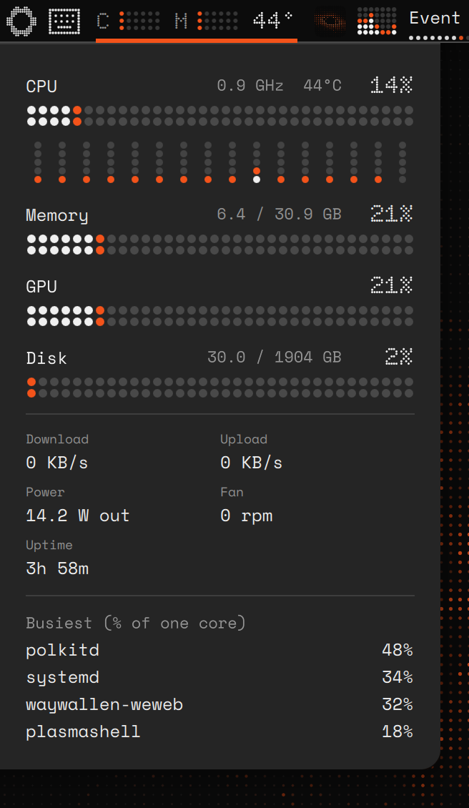 |

| Desktop clock and player | Keyboard shortcuts |
|:---:|:---:|
| 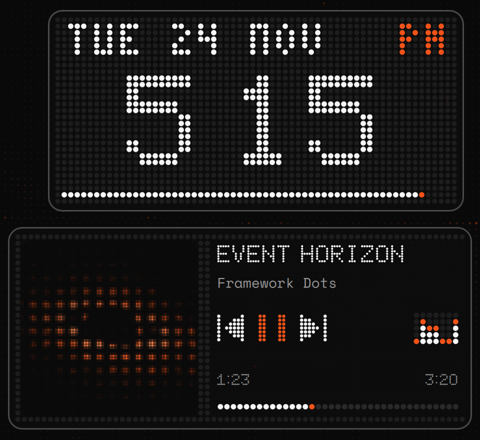 | 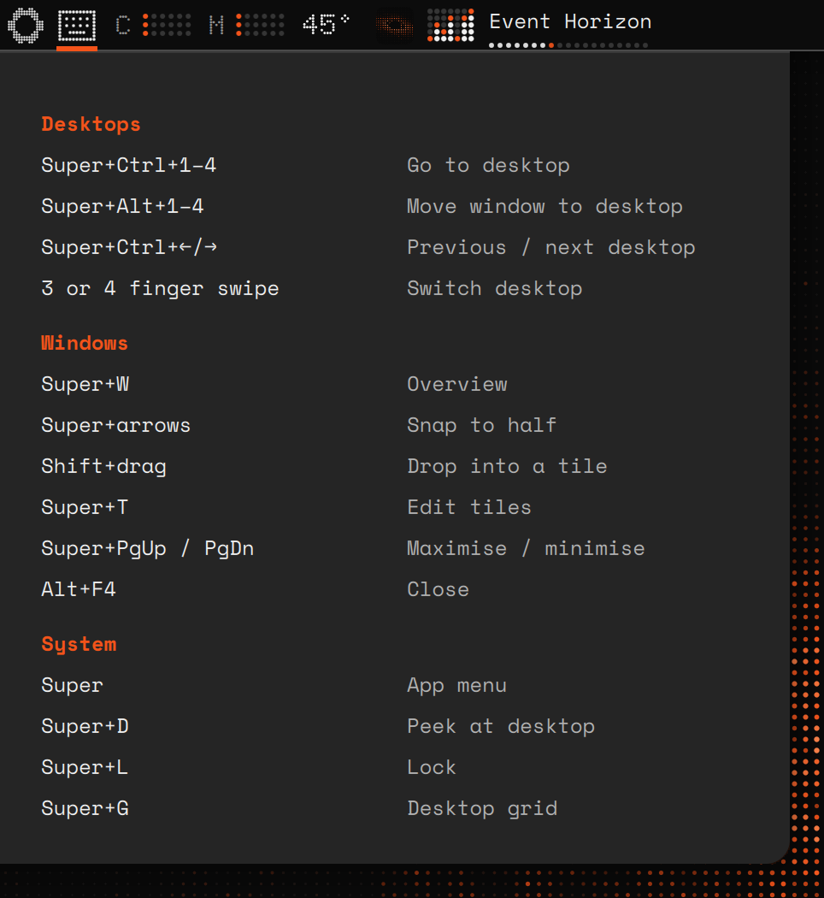 |

| Notification center | Volume pop-up |
|:---:|:---:|
| 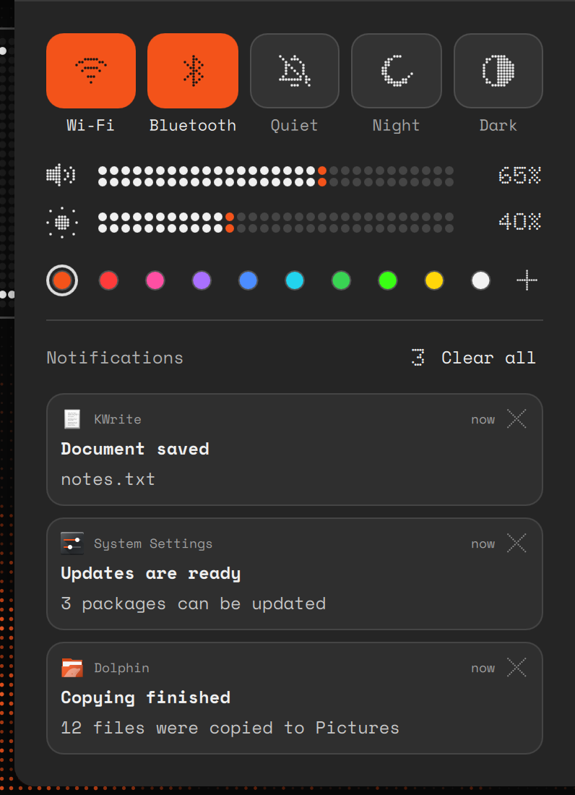 | 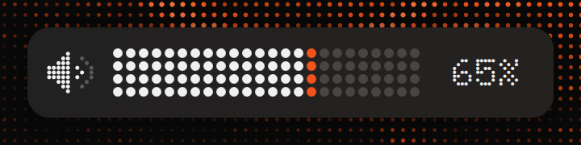 |

| Focus timer | Claude Code usage |
|:---:|:---:|
| 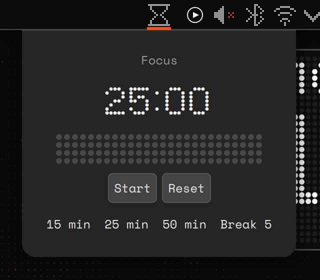 | 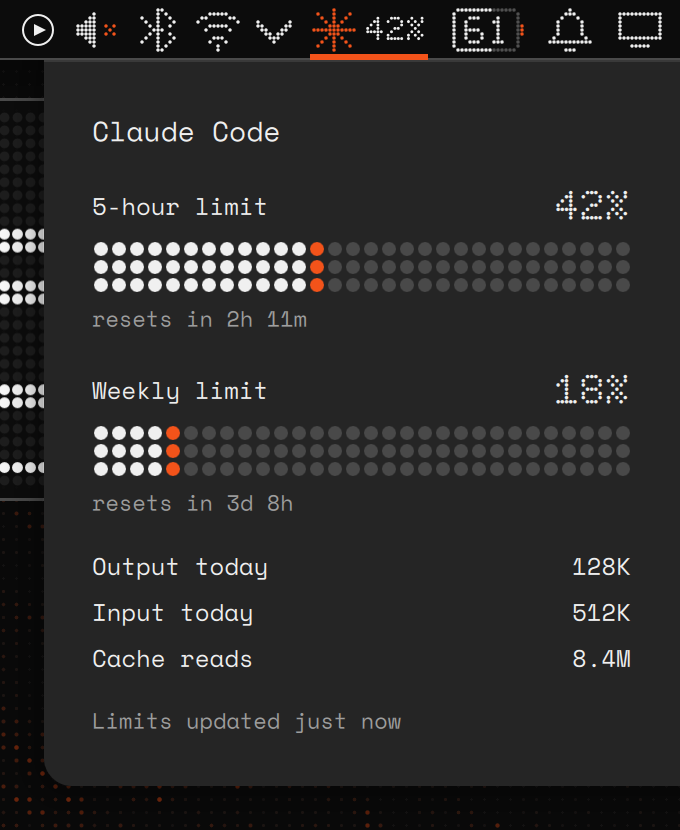 |

New to Linux? This guide assumes no experience. Copy each grey box into a terminal and press Enter.

1. [Will it work on my computer?](#1-will-it-work-on-my-computer)
2. [Install the theme](#2-install-the-theme)
3. [Add the bar, dock and widgets](#3-add-the-bar-dock-and-widgets) (optional)
4. [Set the wallpaper](#4-set-the-wallpaper)
5. [Undo everything](#5-undo-everything)
6. [Something went wrong](#6-something-went-wrong)

---

## 1. Will it work on my computer?

You need **KDE Plasma 6**. To check, open the app menu, search for **About this System**, and look for
**KDE Plasma Version**. If it starts with 6, you're fine. It won't work on GNOME, Cinnamon or XFCE.

### Tested on

I built this on **one computer**, and that's the only one it has been used on:

| | |
|---|---|
| **Computer** | Framework Laptop 13 Pro (Intel Core Ultra X7 358H, Intel Arc B390 graphics, 32 GB RAM) |
| **Screen** | One built-in screen, 2880x1920 at 200% scale |
| **Distro** | CachyOS (based on Arch), kernel 7.3.5 |
| **Desktop** | KDE Plasma 6.8.3 on Wayland (Qt 6.12, KDE Frameworks 6.32) |
| **Moving wallpaper** | Waywallen 0.6.1 with its KDE plugin 0.4.6 and web wallpaper plugin 0.3.4 |

**Not tested:**

| | What to expect |
|---|---|
| Other distros (Fedora, Kubuntu, KDE neon and so on) | Should mostly work on Plasma 6. The volume pop-up is skipped if KDE keeps its files somewhere else |
| Other Plasma 6 versions | Most things should work. The volume pop-up and widgets are the likeliest to break |
| X11 | Unknown |
| Several screens, or 100% scale | Unknown. Dots may look less crisp at 100% |
| NVIDIA or AMD graphics | The theme should be fine. For the moving wallpaper, see Waywallen's notes on NVIDIA |
| Plasma 5, GNOME, XFCE, Hyprland and others | Won't work, though the still wallpapers are just pictures |

The installer and uninstaller were also tested in a fresh, hidden Plasma session on the same computer, but not yet by a real
new user.
If you try it on something else, please open an **Issue** and say how it went.

## 2. Install the theme

**Open a terminal:** open the app menu, type `konsole`, and press Enter. Any terminal will do.

**Copy this in and press Enter:**

```
curl -fsSL https://raw.githubusercontent.com/BocchiTheRockEnjoyer/framework-dots/main/get.sh | bash
```

It downloads the theme and asks a few yes/no questions. Press Enter to accept the suggested answer. Nothing changes until you
say yes to **Install now?** Don't put `sudo` in front. When it says **Done**, **log out and back in**.

<details>
<summary><b>Rather look before you run it?</b> Download it with git instead</summary>

Running a script straight from the internet means trusting whoever wrote it. You can read [get.sh](get.sh) and
[install.sh](install.sh) first, or download everything and run it yourself.

Install git:

| System | Command |
|---|---|
| Arch, CachyOS, EndeavourOS, Manjaro | `sudo pacman -S git` |
| Fedora | `sudo dnf install git` |
| Ubuntu, Kubuntu, KDE neon, Debian | `sudo apt install git` |

It asks for your password. Nothing appears while you type it; that's normal. Then:

```
cd ~
git clone https://github.com/BocchiTheRockEnjoyer/framework-dots.git
cd framework-dots
./install.sh
```

`./install.sh --help` lists options for skipping the questions.

</details>

> **What it changes:** KDE colours, icons, fonts, title bars, splash screen, the volume pop-up and some Dolphin (file manager) settings,
> plus your **kitty** terminal settings if you say yes. It saves your old ones first, in
> `~/.local/share/framework-dots-backup-…`, so you can [undo it](#5-undo-everything).
> `~` means your home folder.

## 3. Add the bar, dock and widgets

Optional. The installer asks about this. If you said no, run it again and say yes; it won't add a second set. Afterwards:

- **Remove your old panel:** right-click it, choose **Show Panel Configuration**, then **Remove** or **Delete**.
- **Keep apps in the dock:** open an app, right-click it in the dock, choose **Pin to Task Manager**.
- **Turn on weather:** right-click the clock in the top bar, choose **Configure**, and type your city.
  Your city is sent to [open-meteo.com](https://open-meteo.com); without one, nothing is sent.
- **Move the desktop widgets:** right-click the desktop, choose **Enter Edit Mode**, and drag them.

The bell opens the **notification center**: Wi-Fi, Bluetooth, quiet mode, night light and dark mode, plus volume and
brightness. Middle-click it for quiet mode. To hide KDE's own bell, right-click the tray arrow, choose
**Configure System Tray**, then **Entries**, and set **Notifications** to **Always hidden**. Pop-ups still appear.

You can also add single widgets: right-click the desktop, **Add Widgets**, and search for **Dot**.

### Light and dark mode

Both are included and follow KDE's light/dark switch. That includes kitty, btop, the terminal looks and the Floorp
theme; btop changes the next time you open it. You can also pick **Framework Dots** or **Framework Dots Light** in
System Settings → **Global Theme** (leave the layout option unticked).
The moving black hole switches too (turn off **Follow light/dark mode** in its settings to stop that).
Still pictures don't; there's a light one called `dot-matrix-blackhole-light.png`.

### Accent colour

Don't want orange? Click the bell and pick a colour, or **+** for any other. You can also open **Accent Colour** from the app menu,
or use a terminal:

```
~/.local/bin/framework-dots-accent '#39ff14'
~/.local/bin/framework-dots-accent purple
~/.local/bin/framework-dots-accent reset
```

It recolours the icons, widgets, windows, terminal looks, wallpapers and Floorp theme. The taskbar restarts, and open apps such as
Floorp and btop need reopening. Very dark colours are lightened so you can see them on black.

## 4. Set the wallpaper

The installer can set the still picture for you. The moving one takes a few more steps.

### Still picture (easy)

1. Right-click the desktop and choose **Desktop and Wallpaper**.
2. Click **Add Image** and open **Pictures → Wallpapers** in your home folder.
3. Pick **dot-matrix-blackhole.png** and click **Apply**.

Or use one command:

```
plasma-apply-wallpaperimage ~/Pictures/Wallpapers/dot-matrix-blackhole.png
```

### Moving wallpaper

The black hole can spin, react to music, and change colour, speed and more. It needs a free app called
[Waywallen](https://github.com/waywallen/waywallen). You **don't** need Steam or Wallpaper Engine.
It uses more battery than the still picture.

**Step 1. Get the apps.** Run the installer again and say yes to the **moving wallpaper app**. It downloads about 235 MB and
checks that the files are genuine. (If you used git, you can run `./wallpaper-setup.sh` instead.)

The taskbar disappears for a moment. That's normal. (It's for ordinary Intel and AMD computers; on ARM, use Waywallen's own guide.)

**Step 2. Add the wallpaper plugin.**
Open **Waywallen** from the app menu. Click the **puzzle piece** at the bottom left, choose to install a plugin, and pick
`web-wallpaper-plugin.zip` in your **Downloads** folder.
Waywallen warns that plugins can access your files, so only add ones you trust. This one comes from Waywallen's makers.

**Step 3. Show it where the wallpapers are.**
Go to **Wallpapers** and click the **drive icon** at the top right. Add this folder, which the theme installer made:

```
FrameworkDots-Wallpapers
```

It's in your home folder. If it asks what kind, choose **Workshop** or **Wallpaper Engine**. Then click **refresh**.

**Step 4. Turn it on.**
Right-click the desktop, choose **Desktop and Wallpaper**, change **Wallpaper type** to **Waywallen**, and click **Apply**.
The desktop may go blank until the next step.

**Step 5. Pick it.**
In Waywallen, click **Dot Matrix Black Hole** and apply it. Open its settings to change the look.
You can close Waywallen's window; the wallpaper keeps running, and it starts by itself when you log in.

**To save battery:** in Waywallen's settings (the gear), pause it when a window is **maximised** or when **on battery**.
Lowering **Particles** and **Dots across the screen** helps too.

**To go back to a picture,** use the command under [Still picture](#still-picture-easy).

## 5. Undo everything

```
bash ~/.local/share/framework-dots/uninstall.sh
```

Then log out and back in. If it says **No such file**, you have an older version:

```
curl -fsSL https://raw.githubusercontent.com/BocchiTheRockEnjoyer/framework-dots/main/uninstall.sh -o /tmp/fd-uninstall.sh && bash /tmp/fd-uninstall.sh
```

**What it does:** removes the theme, its widgets, and the bar and dock, and puts back the settings the theme changed.
Anything you've changed yourself since installing stays as it is. If there'd be no panel left, it adds KDE's standard one.

**What it can't do:** bring back a panel you removed yourself, or undo the optional Floorp theme. Copies of your old settings
stay in `~/.local/share/framework-dots-backup-…`.

## 6. Something went wrong

| Problem | Try this |
|---|---|
| `curl: command not found` or `git: command not found` | Install it the way [step 2](#2-install-the-theme) shows for git |
| `This needs KDE Plasma 6` | See [Will it work on my computer?](#1-will-it-work-on-my-computer) |
| It stopped partway | Run it again, or [undo it](#5-undo-everything) |
| `Permission denied` | Run `chmod +x *.sh` in the theme's folder, then try again |
| `No such file or directory` | Run `cd ~/framework-dots` first |
| Nothing looks different | Log out and back in |
| I changed the Global Theme and lost the icons | System Settings → **Global Theme** → **Framework Dots** or **Framework Dots Light** (don't tick the layout option) |
| The top bar or dock disappeared | Run `systemctl --user restart plasma-plasmashell` |
| I have two bars or docks | Right-click one, **Show Panel Configuration**, and remove it |
| Dots behind the top bar | In its panel configuration, set **Opacity** to **Opaque** |
| Dock dots look uneven | In its panel configuration, set the height to **60** |
| Volume pop-up missing after an update | Run `rm ~/.config/systemd/user/plasma-plasmashell.service.d/dot-osd.conf`, then log out and back in |
| Moving wallpaper is frozen | A maximised window may be pausing it. Otherwise, log out and back in |
| Waywallen shows no wallpapers | Check you added **FrameworkDots-Wallpapers** itself, then refresh or restart Waywallen |
| Waywallen won't open | Run `~/Applications/waywallen.AppImage` in a terminal and read the message |

Still stuck? Open an **Issue** at the top of this page. Say which system and Plasma version you have, and paste the error.

---

## More pictures

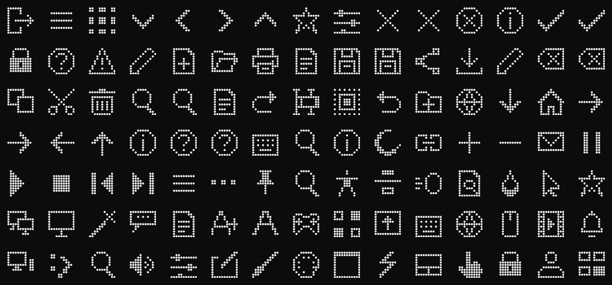
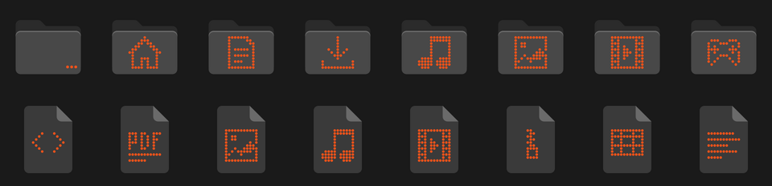

## Optional extras

- **Floorp browser:** copy the two files in `floorp` into the `chrome` folder of your Floorp profile, and restart it.
  If nothing changes, open `about:config` and set `toolkit.legacyUserProfileCustomizations.stylesheets` to true.
- **Terminal looks:** the installer can add a fastfetch logo, a [fish](https://fishshell.com) prompt, a
  [btop](https://github.com/aristocratos/btop) theme and a [cava](https://github.com/karlstav/cava) theme. It doesn't install
  those programs, and never replaces your own configs. Run `cava-dots` for a dotted music visualiser.
- **Claude Code usage widget:** shows tokens by itself. For plan limits, set `statusLine` in `~/.claude/settings.json` to
  `{"type": "command", "command": "~/.local/bin/claude-usage --record"}`. It only reads files on your computer.
- **Colours:** orange `#F3531A`, boards `#0C0C0C`, outline `#4A4A4A`, graphite `#252525` and `#1A1A1A`.
- **For tinkerers:** `sources` has the rough scripts that drew the icons.

## Credits and licence

- Design inspired by [Nothing](https://nothing.tech)'s dot-matrix style
- Made with help from [Claude Code](https://claude.com/claude-code), Anthropic's AI coding tool, which helped write the
  code, draw the icons and write this guide
- [KDE](https://kde.org): Plasma and Breeze. `osd/OsdItem.qml` is modified from Plasma (GPL-2.0-or-later)
- [Space Mono](https://fonts.google.com/specimen/Space+Mono): SIL Open Font License, in `fonts/space-mono/OFL.txt`
- **FD Dots**, the dotted font: a modified version of [Doto](https://github.com/oliverlalan/Doto) by Óliver Lalan, SIL Open
  Font License, in `fonts/fd-dots/OFL.txt`
- Framework logo shape from [Simple Icons](https://simpleicons.org)

Licensed GPL-3.0-or-later, except where noted above. The moving wallpaper uses
[Waywallen](https://github.com/waywallen), a separate project that isn't included here.

Not affiliated with Framework, Nothing, KDE or Anthropic. Their names and logos are their own.
